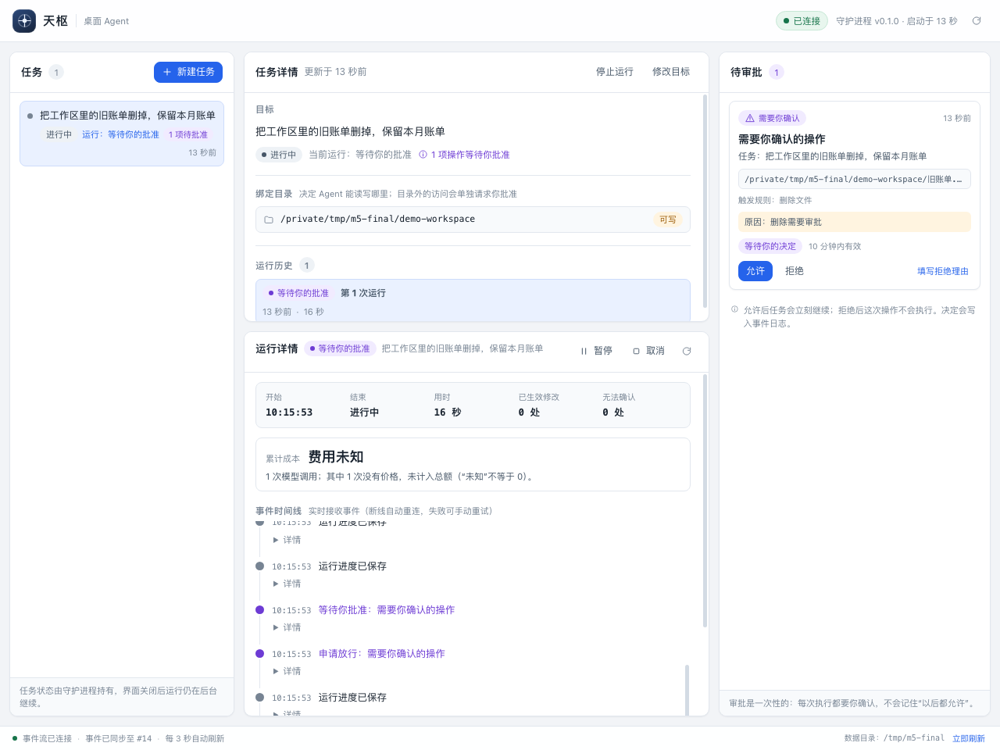

<div align="center">

# 天枢 Agent · Tianshu Agent

**可回放、可审批、可撤销的桌面 Agent OS 内核**

让 AI 在你指定的目录里干活——但每一步副作用都留痕，越权要你点同意，
改坏了能撤销，崩溃了能判定「到底有没有生效」。

[](https://github.com/lorek666/tianshu-agent/actions/workflows/ci.yml)
[](LICENSE)
[](https://www.python.org/)
[](pyproject.toml)

</div>

---



## 这是什么

面向**普通用户**的桌面 Agent。它按单用户、单机设计，支持自选模型、在指定目录读写文件和完成长任务。v1 的范围为文本和文件任务。

它把「AI 可能失控」当成一等工程问题来解，而不是靠 prompt 里写几句「请谨慎操作」。

> **当前形态**：M0–M5 内核与三进程桌面闭环已完成；R0–R3 发行链源码已并入 `main`。
> 首发计划仅提供 **macOS Apple Silicon（arm64）限定预览**。已接入单目标草稿流程，正式工作流实跑和真机验收仍待完成；**尚无可公开安装的发行版**。
> 首发不支持 Intel Mac、Windows 或 Linux。逐条状态见 [docs/status.md](docs/status.md)。

## 核心承诺

| | 承诺 | 怎么做到 |
|---|---|---|
| 🔁 | **可重放** | 事件日志只追加；`replay` 按已记载的事件重建并核对 seq / `messages_hash` / 产物哈希，不调模型、不重做副作用 |
| 🔐 | **执行侧授权** | 授权只在执行侧判定，模型说什么都不算数；覆盖 / 删除 / 执行命令必须**人工审批**，否决即终局 |
| ↩️ | **默认可撤销** | 写前快照 + 可独立核对的凭据（Receipt）；撤销前核对内容哈希，被外部改过就拒绝；撤销本身也走审批 |
| 🧯 | **崩溃可判定** | `applied` / `none_applied` / `unknown` 三态**不合并**，未知绝不盲目重放 |
| 🧵 | **不重复执行** | 跨进程租约 + fencing：防同用户双实例，旧 worker 不得覆盖新 owner |
| 🪶 | **零运行时依赖** | 纯 Python 标准库；换 provider 主循环零改动（OpenAI-compatible / Anthropic 两套协议） |

还有受控出网、受控 MCP、默认只读的子任务、带 React 面板的记忆、定时任务和整数微美元成本账。能力和边界见 [docs/limitations.md](docs/limitations.md)。

## 它不假装能做到的事

- **命令默认走受信任的本地执行。** `Workspace` 只约束内置文件工具。W14 提供按平台选用的 macOS Seatbelt 与 Linux Landlock 子进程后端，隔离范围以审批前的实测报告为准。Windows 进程级沙箱待交付。参见 [F2 执行策略](docs/limitations.md#2-f2-沙箱与执行策略交付的是什么不是什么)。
- **桌面发行仍待验收。** 首发仅验证 Apple Silicon Mac 上的安装、升级与回退；跨平台发行另验。认证发布者签名、公证和自动更新不在本次预览范围；macOS 免费 ad-hoc 资源封套只修复结构完整性，不代表发布者信任或系统放行，见[发行说明](desktop/README.md#macos-资源封套与发布者身份不是同一项)。
- **Windows 验证来自 CI runner。** 命名管道 ACL、杀软、长路径与用户设备安装体验仍待验收。
- **MCP 与联网研究使用本机夹具验收。** W9 已补充连接期 DNS 校验和响应分页。真实第三方 MCP、公开站点研究和搜索 API 仍是待办。
- **真实模型驱动 UI 待验收。** `m4.4` 有两家模型的 CLI 实测。当前 `m4.6` 判据下的真实模型报告待补。见 [评测范围](docs/limitations.md#4-m4-评测的未验证项)。
- **macOS 之外密钥不进系统钥匙串。** 其余平台请求时如实抛 `CredentialUnsupported`，不静默降级。

## 快速开始

需要 Python **3.12**（`>=3.12,<3.13`）与 [`uv`](https://docs.astral.sh/uv/)。运行桌面界面**不需要 Node**（`ui/dist` 已提交）。

```bash
git clone https://github.com/lorek666/tianshu-agent.git
cd tianshu-agent
uv sync --python 3.12
```

跑通一次「阅读目录并生成摘要」（scripted 模型，不联网、不花钱）：

```bash
mkdir -p /tmp/ws && printf '# 季度笔记\n旧账单待整理\n' > /tmp/ws/note.md
uv run tianshu run --workspace /tmp/ws --task "阅读并生成摘要" --out summary.md

# 回放校验这次执行（审计：不调模型）
uv run tianshu replay --run-id run_xxxx
```

想看完整桌面闭环（建任务 → 停在审批 → 断开所有客户端 → 用新连接批准 → 任务自己跑完）：

```bash
uv run python scripts/demo_m5.py --data-root /tmp/m5-demo --auto
```

接真实模型、桌面三进程、UI 构建、退出码与数据目录维护，见 **[docs/cli.md](docs/cli.md)**。

## 常用命令

**Task 是用户看到的那件事，Run 是一次执行**，两者生命周期分离；改目标会立刻 fence 掉旧 Run。

```bash
uv run tianshu task create --goal "整理季度笔记" --workspace /tmp/ws
uv run tianshu approvals list                 # 覆盖 / 删除 / 执行命令都在这里等你批
uv run tianshu approvals approve appr_xxxx
uv run tianshu undo --run-id run_xxxx --workspace /tmp/ws   # 不带 --approve 只预演
uv run tianshu host run --data-root /tmp/ts-data            # 桌面外壳，打印界面地址
```

批准的是「**那个动作**」，不是「那个进程」；改目标 / 改参数会让批准作废。
内核子命令默认用当前目录的 `.tianshu/`，桌面用平台应用目录；加 `--desktop` 可让 CLI 直接操作桌面库。

## 架构一句话

**唯一事实源是事件日志**（SQLite WAL、append-only，触发器禁止 `UPDATE` / `DELETE`），
Task / Run / Approval / Lease 都是同库事务更新的可重建投影。桌面是 UI → Host → IPC → Daemon 三进程，
UI 断开只减少订阅者，任务照跑。五道版本化契约 + 十一条红线约束全局。

源码模块地图见 [docs/TECH-ARCH.md §13](docs/TECH-ARCH.md)，进程与 IPC 规格见 [docs/M5-desktop.md](docs/M5-desktop.md)。

## 文档

| 想干什么 | 看哪份 |
|---|---|
| 查命令、退出码、接真实模型、数据维护 | [docs/cli.md](docs/cli.md) |
| 知道它**做不到**什么 | [docs/limitations.md](docs/limitations.md) |
| 知道现在到哪一步、CI 门禁 | [docs/status.md](docs/status.md) |
| 读权威规格（契约 / 红线） | [docs/PRD-v1.md](docs/PRD-v1.md) §5 / §6 |
| 读技术架构与源码地图 | [docs/TECH-ARCH.md](docs/TECH-ARCH.md) |
| 读三进程拓扑与 IPC 契约 | [docs/M5-desktop.md](docs/M5-desktop.md) |
| 读记忆设计（L0–L3 / 作用域 / 擦除） | [docs/F10-memory-design.md](docs/F10-memory-design.md) |
| 读备份 / 恢复的材料与锁边界 | [docs/backup-restore.md](docs/backup-restore.md) |
| 查当前状态、决策与踩坑教训 | [docs/KNOWLEDGE.md](docs/KNOWLEDGE.md) |
| 查各里程碑判据与验收证据 | `docs/M0-verification.md` … [M5](docs/M5-verification.md) |
| 参与开发 / 让 AI 助手干活 | [CONTRIBUTING.md](CONTRIBUTING.md) · [AGENTS.md](AGENTS.md) |

**改动任何契约前先读 PRD §5、§6。** 红线与功能需求冲突时，以红线为准。

施工规格与验收报告：[SPEC-RELEASE-APP](docs/SPEC-RELEASE-APP-2026-11-15.md)（发行链切片）、
[desktop/README.md](desktop/README.md)（Tauri 壳）、[SPEC-RESIDUALS-MEMORY](docs/SPEC-RESIDUALS-MEMORY.md)、
[F2-ACCEPTANCE](docs/F2-ACCEPTANCE-2026-11-11.md)、[MEMORY-ACCEPTANCE](docs/MEMORY-ACCEPTANCE-2026-11-11.md)、
[REVIEW-PRA](docs/REVIEW-PRA.md)（「自审盲区」教训的来源）、[REFS](docs/REFS.md)（参考仓库与固定 commit）。
[docs/archive/](docs/archive/) 是历史研究记录，**已被 PRD-v1 取代，勿作为实现依据**。

## 贡献

欢迎 issue 与 PR。请先读 [CONTRIBUTING.md](CONTRIBUTING.md)：契约变更需单独 PR，
高危改动（授权 / 租约 / 并发写 / 事件日志 / 计费）需独立复审并附可复现证据，
四项必过检查（Ubuntu / macOS / Windows Python / UI）绿了才能合。

硬约定：Python **3.12** + `uv` + **零第三方运行时依赖**，新增依赖须四目标可用
（`mac-arm64` / `mac-x64` / `win-x64` / `win-arm64`）；`ui/dist` 是**要提交的产物**，改前端必须重建并一起提交；
事务统一走 `EventLog.transaction()`；授权只在执行侧判定。

> **AI 辅助开发**：每次开发前必读 [docs/KNOWLEDGE.md](docs/KNOWLEDGE.md)，结束后更新它；强制指令见 [AGENTS.md](AGENTS.md)。

本地检查：`uv lock --check` → `uv run --frozen pytest` → `uv run --frozen ruff check .`。
测试通过数以该次提交的 CI 日志为准，本文不手写计数。

## 许可证

[Apache License 2.0](LICENSE)（含专利授权）。