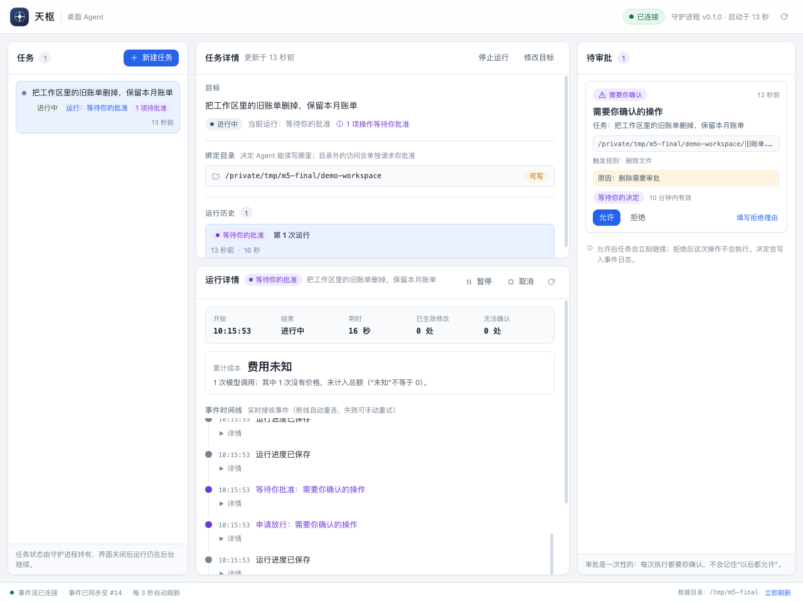

# M5 验收：桌面闭环（实测证据）

> M5 目标（PRD §11）：**Host / UI / Daemon 三进程打通、权限审批 UI**。
> 退出条件只有一句，但它是整个里程碑的判据：**关闭 UI 后任务继续，重启后恢复**。
>
> 设计意图、与 PRD / TECH-ARCH 的偏差登记、已知限制都写在 `docs/M5-desktop.md`；
> 本文是它的**证据附件**：只记录**实际执行过**的东西。没跑的（Windows 实机、
> Tauri/WebView2 外壳与托盘、真实模型、同毫秒并发审批压测）一律列在 §8，
> 不写成“通过”。**测试数量不等于验收项数量。**

- 验收基线：`origin/feat/m5-desktop@43bc45f`
  （`test(m5): accept 的握手失败测试侧也按"可重试"处理（Windows 命名管道偶发）`，
  2026-11-10 14:20 +0800；同一分支上还有 host stop、Windows 平台差异、UI 三缺陷三组修复）
- 独立 worktree：`/private/tmp/ts-wt/m5-verify`
  （`git worktree add … -b docs/m5-verification origin/feat/m5-desktop`）。
  **证据取自这个只放验收文档的干净 checkout**，不取自任何正在被编辑的工作区，
  所以下面每个数字都能被复现，不会因为别人未提交的改动而漂移。
- 平台：macOS 26.6.2（25G83）/ arm64；Python 3.12.13；uv 0.11.7；pytest 9.2.0；
  ruff 0.17.4
- 基线漂移说明：分支在本文件写作期间前进了四站：`daffb89` → `f5da9ef`（host stop 三处
  修复）→ `d132652` / `471c1dd`（Windows 与 Linux 的 accept 唤醒 + 命名管道差异）→
  `43bc45f`（Windows 偶发握手失败的测试侧重试，并合入 UI 三缺陷修复）。各站全量分别是
  1057 / 1060 / 1061 / **1061** passed，3 skipped；**下文每个数字都在 `43bc45f` 上重跑过**，
  没有沿用旧数字。每次前进都新增回归测试，所以数字只会变大，不会"变好看"。

### 复验用的解释器

这台机器没有直连外网（`git fetch` 的代理也连不上），所以验收 worktree 里
**不新建 venv**：借用 Lead worktree 已有的解释器，但把 `PYTHONPATH` 钉死在
被验收的源码上——等价于 `uv run --python 3.12`，区别只是不去解析/安装依赖：

```bash
cd /private/tmp/ts-wt/m5-verify
VENV=/private/tmp/ts-wt/m5/.venv/bin
export PYTHONPATH=$PWD/src:$PWD/tests
$VENV/python -c 'import tianshu; print(tianshu.__file__)'   # → .../m5-verify/src/tianshu/__init__.py
```

## 1. 全量门禁（实跑输出）

```console
$ $VENV/python -m pytest -o addopts="" -q
1061 passed, 3 skipped in 99.08s (0:01:39)

$ $VENV/python -m pytest -o addopts="" --collect-only -q
1064 tests collected in 0.14s        # 1064 = 1061 passed + 3 skipped

$ /private/tmp/ts-wt/m5/.venv/bin/ruff check .
All checks passed!
```

3 条 skip 的逐条原因（`-q -rs`）：

```console
$ $VENV/python -m pytest -o addopts="" -q -rs
SKIPPED [1] tests/test_backend_contract.py:383: memfs 没有符号链接，不承诺这条
SKIPPED [1] tests/test_exec.py:522: 仅 Windows：本机不可执行
SKIPPED [1] tests/test_exec.py:537: 仅 Windows：本机不可执行
1061 passed, 3 skipped in 99.08s (0:01:39)
```

两条 `test_exec` 的 skip 是**真·平台跳过**（这两个用例要求 Windows），不是“没跑
就算过”；它们的 Windows 侧由 CI 矩阵覆盖，本机没有人工复验（见 §8）。

## 2. M5 新增测试清单与条数

条数是 `pytest --collect-only` 的**收集项**（参数化展开后），不是 `def test_` 的
函数个数；两者不同的地方已注明。

| 文件 | 收集项 | 覆盖的面 | 备注 |
|---|---|---|---|
| `tests/test_ipc.py` | 26 | 端点/权限/authkey、帧与大小上限、错误码透传、版本区间协商、推送不串响应、`recv()` 超时 vs 断线、`next_event()` 抛 `ConnectionClosed`、probe、陈旧端点接管、第二个 Server 被拒、Server 关闭能唤醒读者 | 24 个函数 + 1 处 `parametrize`（`test_negotiate_rejects_malformed` 展开 3 项）；本轮新增"关闭能唤醒 accept 线程"（Windows 差异的跨平台回归） |
| `tests/test_host.py` | 28 | Host 单实例/陈旧锁、`/shutdown` 只收 POST+token、`stop_host` 端到端、token 注入（含空 meta / 无 head 三种页面形态）、同源与 `Host` 头校验、路径穿越、SPA 兜底、`/rpc` 代理与 501/超大 body、SSE 回填与 `once`、监护复用/请求关闭/spawn 失败、CLI `host status|stop` | 其中 2 条是本轮 `host stop` 修复新增（见 §5） |
| `tests/test_control.py` | 27 | 控制面方法表逐条：`task.create/list/revise`、`run.start/list/status/pause/resume/cancel`、`state`、`events.run` 分页、`approvals.list/decide`、`undo.plan`、错误码 | 契约视图逐字段核对 |
| `tests/test_daemon.py` | 19 | 首轮跑通、hello 必须先于其它方法、客户端断开后 Run 继续、批准后只续跑一次、长任务期间控制面仍响应、订阅补洞/重连无缺口、重启保 seq、第二实例被拒、陈旧锁接管、两实例并发只一个赢、未决 intent → `reconciling`、恢复不续跑 `waiting_approval`、shutdown 5s 内干净收尾、无 Daemon 时 shutdown=false、驱动线程卡死仍返回、SIGTERM 退出码 0 且释放锁、`stop_event` 路径、**断开后不烧核** | |
| `tests/test_integration_m5.py` | 10 | 真 Daemon + 真 Host 桥 + 真 `ui/dist` 的端到端：跑到终态、审批经 IPC 落地、拒绝即终局、关掉所有客户端后 Run 继续、审批跨重启仍在、第二 Daemon 被拒、**真 `kill -9` 恢复且 receipt 恰一条**、Host 桥服务真 UI、Daemon 消失时 SSE 结束、**`host stop` 连 Daemon 一起收掉** | `test_host_stop_stops_daemon_too` 是本轮新增 |
| **合计** | **110** | | 一个命令跑这五个文件：`110 passed in 49.46s` |

```console
$ $VENV/python -m pytest -o addopts="" -q tests/test_ipc.py tests/test_host.py \
    tests/test_control.py tests/test_daemon.py tests/test_integration_m5.py
110 passed in 49.46s
```

## 3. 退出条件逐条 ↔ 测试名

M5 的退出条件是“关 UI 后任务继续，重启后恢复”。把它拆成可机械核对的分句，
每条都指名到测试；下面这 7 条是单独跑出来的：

```console
$ $VENV/python -m pytest -o addopts="" -v \
    tests/test_integration_m5.py::test_run_keeps_going_after_every_client_disconnects \
    tests/test_integration_m5.py::test_crashed_daemon_recovers_run_without_duplicate_side_effects \
    tests/test_integration_m5.py::test_approval_is_decided_through_ipc_and_run_continues \
    tests/test_integration_m5.py::test_second_daemon_on_same_root_is_refused \
    tests/test_daemon.py::test_stale_lock_is_taken_over \
    tests/test_daemon.py::test_two_daemons_started_concurrently_only_one_wins \
    tests/test_daemon.py::test_shutdown_finishes_quickly_and_leaves_clean_state
…
tests/test_integration_m5.py::test_run_keeps_going_after_every_client_disconnects PASSED [ 14%]
tests/test_integration_m5.py::test_crashed_daemon_recovers_run_without_duplicate_side_effects PASSED [ 28%]
tests/test_integration_m5.py::test_approval_is_decided_through_ipc_and_run_continues PASSED [ 42%]
tests/test_integration_m5.py::test_second_daemon_on_same_root_is_refused PASSED [ 57%]
tests/test_daemon.py::test_stale_lock_is_taken_over PASSED               [ 71%]
tests/test_daemon.py::test_two_daemons_started_concurrently_only_one_wins PASSED [ 85%]
tests/test_daemon.py::test_shutdown_finishes_quickly_and_leaves_clean_state PASSED [100%]
============================== 7 passed in 5.80s ===============================
```

| # | 退出条件分句 | 机械证据（测试名） | 断言的内核 | 本次实跑 |
|---|---|---|---|---|
| 1 | **关掉 UI，任务接着跑** | `test_run_keeps_going_after_every_client_disconnects`（集成）+ `test_run_continues_after_client_disconnects`（Daemon） | 模型卡在第一次调用 → 仅在 Run 为 `running` 时 `client.close()` → 放行后 Run 必须到 `succeeded` 且产物落盘。若推进依赖客户端，Run 会永远停住 | PASSED |
| 2 | **重启后恢复** | `test_crashed_daemon_recovers_run_without_duplicate_side_effects` | 子进程真跑 Daemon → 状态 `running` → **`proc.kill()`（真 `kill -9`，不是 shutdown RPC）** → 新 Daemon → Run 到 `succeeded`；事件 `seq` 无缺口；**`receipt` 事件恰好 1 条**；产物只写一次 | PASSED |
| 2b | 恢复不能被“顺手放行” | `test_pending_approval_survives_restart_and_stays_waiting`；`test_waiting_approval_is_never_resumed_by_recovery` | 重启后仍 `waiting_approval`、文件一个字节没动、审批仍挂在队列且**没有被自动批准** | PASSED（在 §2 的 109 里） |
| 2c | 重启不丢 seq / 能回放历史 | `test_daemon_restart_keeps_event_seq_and_replays_history` | 同一库第二次启动后 `event_seq_head` 延续、历史可回放 | PASSED（在 §2 的 109 里） |
| 3 | **审批在 UI 里落地（走 IPC，不走内存）** | `test_approval_is_decided_through_ipc_and_run_continues`；`test_rejected_action_terminates_and_is_not_reasked` | 批准前目标文件存在；`approvals.decide` 后 `resumed=true`、Run `succeeded`、文件被删；事件里 `approval.requested → decided → consumed → receipt` 齐全且队列清空。拒绝侧：Run `failed` + `effect_state=none_applied`、文件还在、`approval.requested` **恰好一条**、`c4.approval_rejected` 同时出现在 `dispatch.rejected` 与 `tool.result` | PASSED |
| 4 | **单实例** | `test_second_daemon_on_same_root_is_refused`（集成）+ `test_second_daemon_on_same_data_root_is_refused`（Daemon）+ `test_two_daemons_started_concurrently_only_one_wins` | 第二个实例被拒，且**并发抢锁路径**下恰好一个赢、一个拿 `IpcError`（`O_CREAT\|O_EXCL` 竞态窗口） | PASSED |
| 4b | **陈旧锁接管** | `test_stale_lock_is_taken_over`（Daemon）+ `test_stale_host_lock_is_replaced`（Host） | 端点连不上 → 判陈旧 → 接管；正常退出必须把锁一起释放 | PASSED |
| 5 | **shutdown 5 秒内清理干净** | `test_shutdown_finishes_quickly_and_leaves_clean_state` | `request_shutdown(timeout=5)` 为真；`serve()` 5s 内返回；`elapsed < 5.0`；端点不再应答、socket 文件被删、`daemon.lock` 释放；退出后能立刻再起一个 | PASSED |
| 5b | 卡死的驱动线程不许拖住退出 | `test_shutdown_returns_when_driver_thread_is_stuck`；`test_sigterm_exits_zero_and_releases_lock`；`test_stop_event_shuts_down_without_rpc` | 三入口（RPC / SIGTERM / `stop_event`）统一到同一条清理路径；卡死时仍按时返回、锁已释放、没有跨线程关连接的 `ProgrammingError` | PASSED（在 §2 的 109 里） |

> 说明：`receipt 恰一条`、`approval.requested 恰一条`、`elapsed < 5.0` 这些数字不是
> 我从日志里数出来的，而是**测试里的断言本身**；本文把它们抄出来是因为它们定义了
> “恢复”与“不重复副作用”的判定口径。测试红，就是这些口径破了。

## 4. 演示脚本实跑（脚本模型，不联网、不花钱）

```bash
cd /private/tmp/ts-wt/m5-verify
$VENV/python scripts/demo_m5.py --data-root /tmp/ts-verify-demo --auto
```

实跑输出（节选，原文照抄）：

```console
界面地址：http://127.0.0.1:51793/
演示工作区：/tmp/ts-verify-demo/demo-workspace
Run 停在审批：run_85566bb68e22（这期间文件不能动）
审批卡片：动作=delete 目标=['/private/tmp/ts-verify-demo/demo-workspace/旧账单.txt'] 原因=删除需要审批
文件还在吗：True
已断开所有客户端（等价于关掉 UI）
已批准，等待任务自己跑完（没有 UI 参与）
{
  "final_state": "succeeded",
  "outcome": "succeeded",
  "effect_state": "applied",
  "files": [
    "本月账单.txt"
  ],
  "event_types": [ … 34 条 … ],
  "url": "http://127.0.0.1:51793/"
}
[tianshu-daemon] 收到 shutdown（reason=demo）
[tianshu-daemon] daemon 退出（reason=demo）
```

- 退出码 `0`（脚本内断言：审批生效后 `旧账单.txt` 必须消失、`本月账单.txt` 保持不动）。
- `effect_state=applied`、`files` 只有 `本月账单.txt`：批准**之前**文件在（`文件还在吗：True`），
  批准**之后**才删，且只删这一个。
- 事件序列 34 条，按顺序（原文照抄）：

```
run.start → job.enqueued → job.claimed → run.state → model.intent → model.result →
run.model_turn → run.cursor → approval.requested → dispatch.requested → run.cursor →
run.state → job.parked → approval.decided → job.claimed → run.state → dispatch.requested →
approval.consumed → grant.issued → grant.consumed → tool.intent → dispatch.admitted →
execution.started → tool.result → receipt → run.effect → run.cursor → model.intent →
model.result → run.model_turn → run.cursor → job.finished → run.end → run.finish
```

关键形态：`approval.requested` 之后是 `job.parked`（等人），`approval.decided` 之后
`job.claimed` 才重新出现——**“断开客户端”这一步夹在 `job.parked` 与批准之间，
Run 照样跑完**，这就是退出条件 1 的手工证据；而 `receipt` 只有一条，是退出条件 2
在真实链路上的形态。

## 5. Host 生命周期（本轮修掉的三个缺陷）

这一节是本轮**真实修掉**的 Bug，不是设计说明。三个缺陷叠在
`tianshu host run` → `tianshu host stop` 这同一条路径上，任何一个都足以让
“Host 停不干净”或“Daemon 变孤儿”。

### 5.1 实测（真进程，非进程内调用）

```bash
cd /private/tmp/ts-wt/m5-verify
rm -rf /tmp/ts-verify-host

# 1) 起真 Host（带监护；它会自己拉起 Daemon）
PYTHONPATH=$PWD/src nohup $VENV/python -m tianshu host run \
  --data-root /tmp/ts-verify-host --port 0 > /tmp/ts-verify-host.log 2>&1 &
sleep 10; cat /tmp/ts-verify-host.log
```

```console
天枢 Agent 已启动：http://127.0.0.1:51719/
```

进程树（此时 Host 与 Daemon 各一个，Daemon 是独立进程）：

```console
$ pgrep -fl 'tianshu (host|daemon) --data-root /tmp/ts-verify-host'
57010 …/python -m tianshu host run --data-root /tmp/ts-verify-host --port 0
57011 …/python -m tianshu daemon --data-root /tmp/ts-verify-host --model scripted --max-turns 8 --max-total-tokens 20000
```

```bash
# 2) 停
PYTHONPATH=$PWD/src $VENV/python -m tianshu host stop --data-root /tmp/ts-verify-host
echo "[stop exit=$?]"
```

```console
Host 已退出
[stop exit=0]
```

```bash
# 3) 立刻检查有没有孤儿（不等待、不宽限）
pgrep -fl 'tianshu (host|daemon) --data-root /tmp/ts-verify-host'   # 空
ls -la /tmp/ts-verify-host/run/
```

```console
（pgrep 输出为空 = Host 与 Daemon 都不在了）
total 8
drwx------@ 3 ronfee  wheel   96 Nov 10 09:44 .
drwxr-xr-x@ 6 ronfee  wheel  192 Nov 10 09:44 ..
-rw-------@ 1 ronfee  wheel   32 Nov 10 09:43 ipc.key
```

`run/` 里**只剩常驻密钥 `ipc.key`**（0600，32 字节）；`agent.sock`、`daemon.lock`、
`host.lock` 都已消失。收尾用的是 `host stop`，**没有用 `kill -INT`**：后台 shell
启动的 python 会继承 `SIG_IGN`，`kill -INT` 根本到不了进程，那是环境陷阱，
不是产品行为。

### 5.2 三个缺陷与对应测试（可复现的回归说明）

| # | 缺陷（修前实测形态） | 根因 | 修法 | 钉住它的测试 |
|---|---|---|---|---|
| ① | `tianshu host stop` 永远拿到 404，只打印“Host 未在超时内退出”并返回 1 | `/shutdown` 端点注册在 `do_GET`，而 `stop_host()` 发的是 **POST**；更糟的是 GET 会落到 SPA 兜底回 **200 + index.html**，让人以为“通知成功了” | 只接受 **POST + token**；GET 明确回 **405**，不许落兜底 | `test_shutdown_endpoint_is_post_only_and_requires_token`（GET 405 / 无 token 401 / POST 200 且回调真被调用） |
| ② | 回调“调了但什么也没发生”，清理线程静默死掉 | 清理回调被赋给 `_Handler` 的**类属性**：普通函数成为类属性会被描述符协议绑定，调用时多塞一个 handler 实例当 `self` → `TypeError` | 回调挂到 **server 实例**（`self.server.stop_callback`），不挂 handler 类 | `test_stop_host_stops_a_running_host_and_clears_info`（`stop_host()` 返回 0、端口关闭、`host.lock` 清掉） |
| ③ | `stop` 报“Host 已退出”，但 **Daemon 留成孤儿**继续占 socket、继续能接活 | `stop_all()` 先置 `stop_event` 再清理：主线程立刻从 `run_host` 返回，进程退出把正在关 Daemon 的清理线程一起带走 | **清理完成之后**才放主线程退出（`stop_requested` 负责去重，重复点 `/shutdown` 不重复清理） | `test_host_stop_stops_daemon_too`（**真子进程**跑 `host run` → `stop_host` → 进程退出后立刻 `ipc.probe` 必须为假） |

三条测试单独跑的结果：

```console
$ $VENV/python -m pytest -o addopts="" -v \
    tests/test_host.py::test_shutdown_endpoint_is_post_only_and_requires_token \
    tests/test_host.py::test_stop_host_stops_a_running_host_and_clears_info \
    tests/test_integration_m5.py::test_host_stop_stops_daemon_too
…
tests/test_host.py::test_shutdown_endpoint_is_post_only_and_requires_token PASSED [ 33%]
tests/test_host.py::test_stop_host_stops_a_running_host_and_clears_info PASSED [ 66%]
tests/test_integration_m5.py::test_host_stop_stops_daemon_too PASSED     [100%]
============================== 3 passed in 5.96s ===============================
```

**为什么 ③ 必须在子进程里测**：在 pytest 进程内跑 `run_host`，进程退出后主线程
没了但 pytest 进程还活着，清理线程不会被带走——Bug 会躲过去。这条测试是
“进程语义”的测试，不是“函数语义”的测试。

## 6. 断线不烧核：回归证据

这是 M5 实测踩到的第二个真 Bug：客户端断开后，服务端读线程把“超时”和“EOF”都
当成“这一刻没消息”，`poll()` 立刻报可读 → `recv_bytes()` 立刻 EOF 的循环把
**一个核烧满**，直到进程被杀；同时 SSE 也不会结束，浏览器永远显示“事件流已连接”。

```console
$ $VENV/python -m pytest -o addopts="" -q \
    tests/test_daemon.py::test_client_disconnect_does_not_spin_a_cpu_core \
    "tests/test_integration_m5.py::test_event_stream_ends_when_daemon_goes_away"
..                                                                       [100%]
2 passed in 8.11s
```

两条测试验的是两个不同后果：

- `test_client_disconnect_does_not_spin_a_cpu_core`：**子进程**跑真 Daemon，用
  `time.process_time()` 自己记账——`client.close()` 后观察 1.5s，CPU 时间必须
  `< 0.5s`。空转时 1.5s 会吃掉约 1.5s CPU。它同时证明“读线程退出了”这个修法。
- `test_event_stream_ends_when_daemon_goes_away`：真 Host 桥 + 真 SSE 连接 →
  `daemon.request_shutdown()` → 5s 内流必须**结束**（收到 EOF）。若把它当“这一刻
  没事件”，就会一边空转发心跳一边烧核，浏览器永远等不到流结束。

语义口径（契约见 `docs/M5-desktop.md` §3.6）：`ServerConnection.recv()` 超时返回
`None` 且 `eof=False`，对端断开返回 `None` 且 `eof=True`；`Client.next_event()`
断线抛 `ConnectionClosed`。对应单测 `test_peer_close_is_distinguishable_from_timeout`、
`test_subscription_drop_raises_instead_of_returning_none`（都在 §1 的全量里通过）。

## 6.5 Windows 平台差异：CI 抓出来的三个真缺陷（本机复现不了）

M5 的 IPC 是**跨平台实现**（POSIX 用 AF_UNIX、Windows 用命名管道），但本机只有
macOS。这一节记录的是**只有 Windows CI 才暴露**的缺陷——它们不是"CI 慢"或"runner
环境怪"，而是真实的平台语义差异，且都已修、都有回归测试。

| # | 现象（Windows CI） | 根因 | 修法 | 回归测试 |
|---|---|---|---|---|
| ① | daemon 已"退出"，`probe()` 仍为真；重启/接管类测试全拿到「端点已被占用（抢锁后探测）」，第二个 `CreateNamedPipe` 抛裸 `PermissionError(WinError 5)` | accept 阻塞在 `ConnectNamedPipe` 的 **overlapped I/O** 上，从别的线程关 listener 句柄**不会取消**挂起的 I/O：accept 线程永远卡住，命名管道对象也一直存在 | `Server.close()` 关 listener 前先"敲门"唤醒 accept（Windows 用 `os.open`），daemon 的 accept 循环收到唤醒连接时若 stop 已置就关掉并退出 | `test_server_close_unblocks_accept_thread` |
| ② | 同一批测试里"断线"表现不一致 | Windows 上对端断开不一定表现为 `poll()` 返回 True + `recv` 抛 EOF，`PeekNamedPipe` 会**直接抛** `BrokenPipeError/OSError` | `ServerConnection.recv()` 把 `poll()` 一并纳入断线处理（置 `eof`） | `test_peer_close_is_distinguishable_from_timeout`（在 Windows 上走的是抛错分支） |
| ③ | 重复实例的错误类型不可判别 | `Server.start()` 直接 `CreateNamedPipe`，同名管道已 Listening 时抛裸 `PermissionError` | 与 POSIX 一样先 `probe()`，翻译成 `IpcError("端点已被占用")` | `test_second_server_on_same_root_is_refused` |

**还有一条是 Linux 才暴露的**：第一版只给 Windows 加了"敲门"，结果 ubuntu job 红了
——关掉正在被 `accept()` 使用的 fd **不会可靠唤醒**阻塞中的 syscall（macOS 会，Linux
不会）。于是"敲门"提成 `Server._wake_accept()`，两个平台都做（见提交
`471c1dd`）。这说明"本机绿"对跨平台阻塞语义几乎没有证明力。

### 尚未解决：Windows 命名管道上 accept 的偶发握手失败

同一个 commit 在 Windows 上每轮失败**条数不同、名字不同**（先后出现 6 条 → 2 条 →
1 条），表现统一是：`server.accept()` 拿到一条握手失败的连接，抛
`ProtocolError("…可重试…digest received was wrong")`。产品契约本来就要求调用方把这类
失败当"可重试"（daemon 的 accept 循环就是 `continue`），所以**产品侧不需要改**；但
测试里直接 accept 一次就把它当故障了，属测试写得比调用方苛刻。

处置：测试侧新增 `_accept_retrying()`，与生产同构地重试握手失败（最多 20 次 / 间隔
50ms）。**根因未定位**——不排除是命名管道实例队列与探活/半开连接之间的时序竞态。
这条**不算已解决**，如实记在这里；要根治需要在 Windows 实机上复现（见 §8）。

## 7. UI 截图（真 Daemon + 真 `ui/dist` + 真 Host 桥）



`docs/m5-ui.png`，**1280×960**，SHA-256
`5480de75b7c094ab53bfcee67864f8008880e82be76e200b34bfe2f08d591b6c`。

怎么拍出来的（**没有用现成截图**）：

```bash
cd /private/tmp/ts-wt/m5
rm -rf /tmp/m5-final /tmp/m5-chrome-final

# 交互模式：建任务 → 停在"等你审批"，然后一直开着
nohup uv run --python 3.12 python scripts/demo_m5.py   --data-root /tmp/m5-final > /tmp/m5-final.log 2>&1 &
sleep 12; cat /tmp/m5-final.log            # → 界面地址：http://127.0.0.1:54529/

URL=$(grep -o 'http://127.0.0.1:[0-9]*/' /tmp/m5-final.log | head -1)
"/Applications/Google Chrome.app/Contents/MacOS/Google Chrome" \
  --headless=new --disable-gpu --no-first-run --user-data-dir=/tmp/m5-chrome-final \
  --virtual-time-budget=4000 --window-size=1280,960 \
  --screenshot=/private/tmp/ts-wt/m5/docs/m5-ui.png "$URL"

# 收尾
uv run --python 3.12 python -c "from pathlib import Path; from tianshu import daemon; \
  print(daemon.request_shutdown(Path('/tmp/m5-final'), reason='verify', timeout=5))"   # → True
```

- 截图源是**真进程**：`scripts/demo_m5.py` 起一个真 Daemon（脚本模型，不联网）+
  真 `UiBridge`（`src/tianshu/host.py`）服务仓库里的**真 `ui/dist`**
  （`ui/dist/assets/index-C-Sd-fLE.js`、`index-DaurBwut.css`）。页面里的数据全部经由
  `POST /rpc`、`GET /events`（SSE）、`GET /state` 拿，没有 mock。
- 页面里能看清的（与截图像素逐处核对）：
  - 顶部右上：**「已连接」** + **「守护进程 v0.1.0 · 启动于 13 秒」**；
  - 左侧任务卡：**「进行中 · 运行：等待你的批准 · 1 项待批准」**；
  - 「目标」区：**「进行中」**、「当前运行：等待你的批准」、「① 1 项操作等待你批准」；
  - **「绑定目录 `/private/tmp/m5-final/demo-workspace` · 可写」**；
  - 时间线：「运行进度已保存」「等待你批准：需要你确认的操作」「申请放行：需要你确认的操作」；
  - 右侧审批卡片：**「需要你确认」→「需要你确认的操作」→ 任务 → 路径 →
    「触发规则：删除文件」→「原因：删除需要审批」→「等待你的决定 · 10 分钟内有效」→
    按钮「允许」「拒绝」「填写拒绝理由」**，且三个按钮/链接**在首屏可见**；
  - 底部状态栏：**「事件流已连接 · 事件已同步至 #14 · 每 3 秒自动刷新」** 与
    「数据目录：/tmp/m5-final」。
- 这一版是**修完三个 UI 缺陷之后**拍的（见 §10）：任务状态不再是「状态未知」、
  右上有守护进程版本、1280 宽下审批按钮回到首屏。修之前的三张对照图与后续工单
  记录见 §10；**同一视口、同一流程**，只差这三处。
- 收尾后确认无残留：`pgrep -fl 'demo_m5.py --data-root /tmp/m5-final'` 与
  `pgrep -fl 'Google Chrome.*m5-chrome-final'` 都为空。

## 8. 未验证（不许说成已验证）

| 项 | 为什么没验 / 现在的证据到哪 |
|---|---|
| **Windows 实机** | 本机只有 macOS arm64。命名管道、ACL、`taskkill`、长路径、杀软干扰都没有实机复验；`test_exec` 的 2 条 Windows 用例在本机是 skip。Windows 只有 CI 矩阵覆盖（非本机人工复验）。**并且 CI 上仍有未根治的偶发握手失败**，见 §6.5 末节 |
| **Windows 命名管道 accept 的偶发失败根因** | §6.5 末节：现象与处置都有，但**根因未定位**。测试侧已按契约重试，产品侧无需改；要根治必须在 Windows 实机上抓管道实例队列的时序 |
| **Tauri / WebView2 外壳与托盘** | M5 没有外壳（`docs/M5-desktop.md` §2 D1/D2/D5）：UI 是系统浏览器里的单页应用。安装包、签名、公证、自动更新、托盘、开机自启、`open` 事件转发都**未做也未验** |
| **真实模型** | 本机无可用 API key。演示与所有 M5 测试用的是脚本模型（`DemoModel` / `ScriptedModel` / `FakeModel`），只能证明“系统在正确的时候做正确的事”，**不能证明真实模型的工具选择、审批意愿、上下文行为**。`累计成本/费用未知` 在截图里也是这个原因（“未知”不等于 0） |
| **同毫秒并发审批压测** | 只验证了“先后顺序”（审批一次性、拒绝即终局、重复 decide 不重复放行），**没有做**两条连接同一瞬间分别 approve/reject 同一张卡的压力测试；控制面是单线程串行、语义上不会并发处理，但这是推理，不是压测结论 |
| 双 Daemon 同时启动的**概率** | `test_two_daemons_started_concurrently_only_one_wins` 用 `threading.Barrier` 制造竞态，跑通不等於覆盖所有调度；没有做 N 次重复的抖动统计 |
| 长时间浸泡 | 全套测试约 95s，演示约 5s 级；没有 10 小时级运行、没有内存/句柄泄漏曲线 |
| Daemon 崩溃 → Host 指数退避重启 | `docs/M5-desktop.md` §4.3 写了 1s/2s/4s/8s 上限 30s 的监护策略，但**本轮没有实测“连续杀死 Daemon 观察退避”**这条路径（只验了崩溃恢复本身与 Host 退出） |
| 陈旧锁 2 秒宽限窗 | 见 §9 第 2 条：代码存在的理论窗口没有用“超大库 + 慢恢复”去实测 |

## 9. 已知限制（照抄 `docs/M5-desktop.md` §10，不美化）

1. **Daemon 生命周期不写事件日志。** C3 的事件类型是封闭集合、且每条事件都挂
   `run_id`；`shutdown(reason)` 是进程级事实，硬塞进 run 作用域的日志会同时污染
   “按 run 回放”与事件注册表。取舍：`reason` 只进日志文件（`logs/daemon.log`），
   排障时看文件。要进事件日志就得新增 `daemon.*` 族并走 `docs(contract)`，留给后续工单。
2. **陈旧锁判定有 2 秒宽限窗。** 锁“新鲜”用 `started_at` 距今 <2s 判断；若第一个
   Daemon 在“拿到锁 → bind”之间耗时超过 2s（超大库的恢复扫描），第二个实例理论上
   可能误判陈旧并接管。TECH-ARCH §2.2 要求“PID + 启动时间匹配”更稳，但跨平台读取
   进程启动时间没有 stdlib 方案（Windows 需 WMI/PowerShell），属单独工单。
3. **推送在主循环里同步发送。** 一个不读数据的订阅者理论上能拖慢 RPC 响应。彻底
   解法是独立发送线程 + 非阻塞写；M5 用“本地 socket + 每批 256 条”把风险压在可
   接受范围，没有做这一层。
4. **驱动线程卡死 >5 秒时，连接刻意不跨线程关闭。** 关闭一条正在被别的线程使用
   的 SQLite 连接只会得到没人看得到的 `ProgrammingError`，还可能截断一次写入。
   取舍：保留连接，交给进程退出回收；测试钉住“shutdown 仍返回、锁已释放、没有
   ProgrammingError”。
5. **Windows 命名管道只做了 CI 覆盖，没有实机验证。** 传输层按 `ipc.py` 的抽象写，
   `windows-latest` 会跑同一套测试；但“实机”与“runner”的差异（杀软、ACL、长路径）
   不在本里程碑的验证范围内。
6. **同一毫秒的并发审批未压测。** 控制面是单线程串行处理，语义上天然不会并发；
   但“两条连接同一瞬间分别 approve/reject 同一张卡”只验证了先后顺序，没有做压力测试。
7. **`approvals.decide` 的 `reason` 被忽略。** 见 §3.4 表：审批记录没有自由文本字段，
   要存就得改 `schemas/m2/approval.json`（契约变更）。当前它只用于 UI 展示。

## 10. 实测中发现、并已修掉的三个 UI 缺陷

这三条是拍真图、读渲染 DOM、核对源码时发现的。**本轮已修**（提交
`ea95761 fix(ui): 补齐任务状态/守护进程版本人话映射，1280 宽审批按钮回到首屏`，
只动 `ui/`，`ui/dist` 同步重建、漂移门禁为空），修复后重新拍了 §7 那张图。

| # | 缺陷（修前） | 根因 | 修法 | 现在的证据 |
|---|---|---|---|---|
| ① | 任务状态恒显示「状态未知」 | `schemas/m2/task.json` 的 `status` 枚举是 `["open","closed"]`，而 `ui/src/lib/humanize.ts` 的 `TASK_STATUS_LABELS` 只 `...RUN_STATE_LABELS` + `idle/succeeded/cancelled`——两个真值都没映射，`taskStatusLabel()` 永远落兜底 | 补 `open=进行中`、`closed=已结束`（task.status 与 run.state 不是一套枚举，不混用）；任务卡的运行提示改显示当前 Run 的人话状态，避免与任务状态重复 | 截图左侧任务卡「进行中 · 运行：等待你的批准」，目标区「进行中」；`humanize.test.ts` 新增用例 |
| ② | 守护进程版本恒显示「版本未知」 | 后端 `control.py` 在 `state.daemon` 里给的字段名是 `daemon_version`，UI 侧 `api/normalize.ts` / `api/host.ts` 读的是 `record.version` → 永远 `null` | UI 侧改为**优先 `daemon_version`、保留 `version` 兼容**（不改后端：字段名已在 `docs/M5-desktop.md §3.4` 的契约视图里） | 截图上「守护进程 v0.1.0 · 启动于 13 秒」；新增 5 条 vitest 断言 |
| ③ | 宽度恰好 1280px 时审批按钮落在可视区外 | `@media (max-width: 1280px)` 把审批面板移到 258px 高的底部行，卡片内容（动作/任务/路径/规则/原因/状态/按钮/脚注）高于该行 | 断点从 1280 降到 1180（1280 保持三栏设计意图）；1180 以下底部行由固定 258px 改为内容撑开 + `max-height: 42vh`，**不靠隐藏内容换可见性** | 1280×960 与 1024×960 两张截图里「允许/拒绝」都在首屏；`ui/dist` 重建后与源码一致 |

三条回归都靠**能被人看见的东西**验证，不是靠断言内部函数：截图（1280 与 1024 两个视口）
+ `pnpm --dir ui run typecheck`（无输出）+ `test`（`Tests 44 passed (44)`）+
`build`（`✓ built in 432ms`）+ `git diff --exit-code -- ui/dist` 为空。

> 遗留（**这条没修，单开工单**）：真实 Daemon 的审批事件里 `action` 不是 C4 rule id
> （例如 `delete_file`），`rule_id` 才是 `c4.delete`。UI 的事件标题当前 action 优先，
> 所以时间线里部分标题落成兜底「需要你确认的操作」（卡片「触发规则」仍正确显示
> 「删除文件」）。修法是"已知 action 优先，否则回退 rule_id"。

## 11. 复验清单（一条一条跑，数字应能对上）

```bash
cd /private/tmp/ts-wt/m5          # 或任意指向 feat/m5-desktop 的干净 checkout
VENV=/private/tmp/ts-wt/m5/.venv/bin
export PYTHONPATH=$PWD/src:$PWD/tests

# 1) 全量门禁：1061 passed, 3 skipped (≈0:01:43)
$VENV/python -m pytest -o addopts="" -q
$VENV/bin/ruff check .              # All checks passed

# 2) M5 五个文件：110 passed
$VENV/python -m pytest -o addopts="" -q tests/test_ipc.py tests/test_host.py \
  tests/test_control.py tests/test_daemon.py tests/test_integration_m5.py

# 3) 退出条件 7 条：7 passed
$VENV/python -m pytest -o addopts="" -q \
  tests/test_integration_m5.py::test_run_keeps_going_after_every_client_disconnects \
  tests/test_integration_m5.py::test_crashed_daemon_recovers_run_without_duplicate_side_effects \
  tests/test_integration_m5.py::test_approval_is_decided_through_ipc_and_run_continues \
  tests/test_integration_m5.py::test_second_daemon_on_same_root_is_refused \
  tests/test_daemon.py::test_stale_lock_is_taken_over \
  tests/test_daemon.py::test_two_daemons_started_concurrently_only_one_wins \
  tests/test_daemon.py::test_shutdown_finishes_quickly_and_leaves_clean_state

# 4) 断线不烧核：2 passed
$VENV/python -m pytest -o addopts="" -q \
  tests/test_daemon.py::test_client_disconnect_does_not_spin_a_cpu_core \
  "tests/test_integration_m5.py::test_event_stream_ends_when_daemon_goes_away"

# 5) 演示（不联网、不花钱）：退出码 0，final_state=succeeded / effect_state=applied
$VENV/python scripts/demo_m5.py --data-root /tmp/ts-verify-demo --auto

# 6) Host 生命周期（见 §5）：起 → 停 → 无孤儿
rm -rf /tmp/ts-verify-host
PYTHONPATH=$PWD/src nohup $VENV/python -m tianshu host run \
  --data-root /tmp/ts-verify-host --port 0 > /tmp/ts-verify-host.log 2>&1 &
sleep 10; cat /tmp/ts-verify-host.log          # 天枢 Agent 已启动：http://127.0.0.1:PORT/
PYTHONPATH=$PWD/src $VENV/python -m tianshu host stop --data-root /tmp/ts-verify-host
pgrep -fl 'tianshu (host|daemon) --data-root /tmp/ts-verify-host'   # 应为空
ls /tmp/ts-verify-host/run/                                        # 只剩 ipc.key
```

跨平台说明：以上全部在 macOS 上跑。Linux / Windows 由 CI 矩阵跑同一套用例；两边
各自的平台差异缺陷记录在 §6.5，其中 Windows 命名管道的**偶发握手失败根因未定位**，
测试侧按契约重试，如实标注为未解决。
